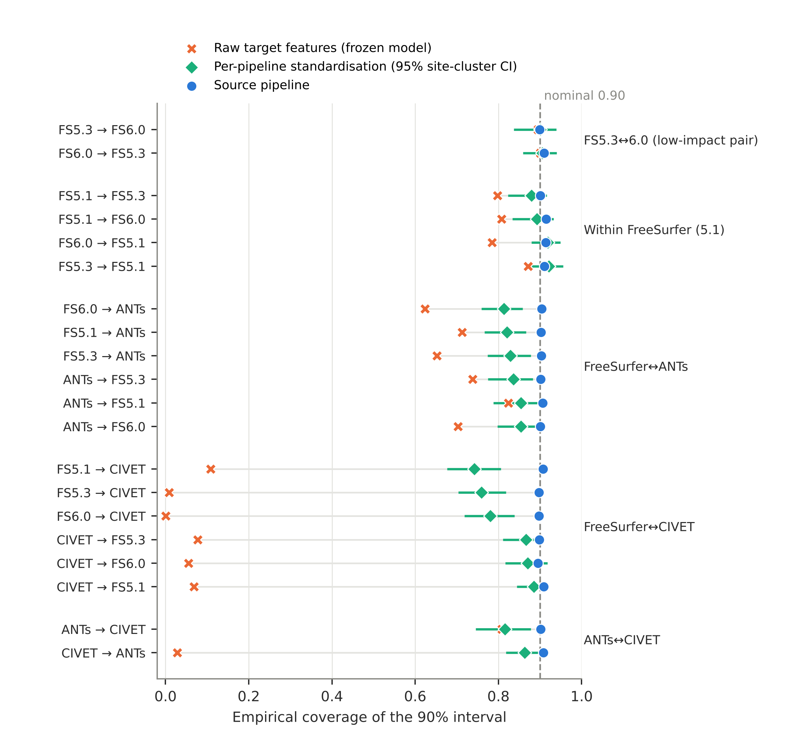
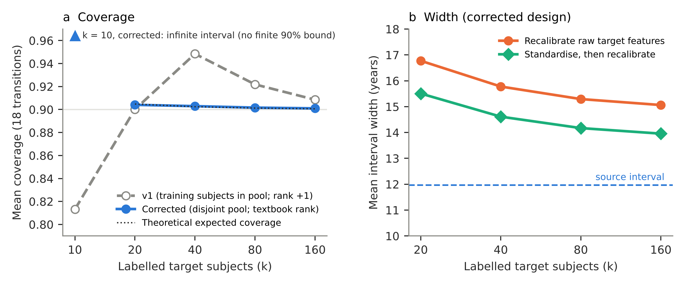
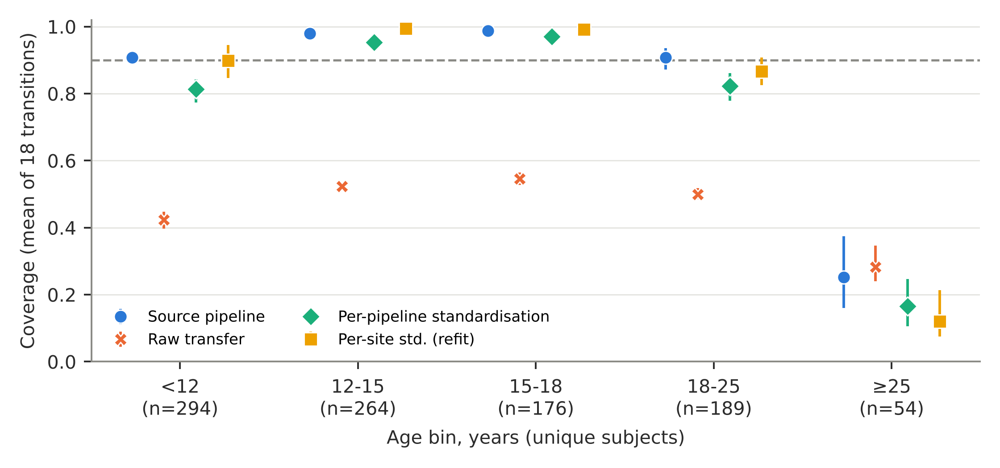

**Authors:** [Full given and family names, in submission order]^a^

^a^ [Department, institution, full postal address, country]

**Corresponding author:** [Name, email address — published with the article]

# Abstract

**Background.** Brain-age prediction intervals calibrated on one structural MRI pipeline may be applied to features from another. Split-conformal guarantees require exchangeability, which re-processing can break even for identical scans.

**Methods.** In ABIDE I, five pipelines (FreeSurfer 5.1, 5.3 and 6.0, ANTs, CIVET 2.1) processed the same scans (matched N = 692–967 per pair). A ridge model with a 90% split-conformal interval was fitted on one pipeline and applied, frozen, to the same test subjects' features from each other pipeline (20 directed transitions). We evaluated label-free standardisation, refitting, weighted conformal prediction, labelled recalibration in a disjoint split, and an MMD drift monitor, with site-clustered paired inference.

**Results.** Source coverage averaged 0.904. Unadapted transfer covered 0.001–0.871 (median 0.678) across 18 transitions. Per-pipeline standardisation raised mean coverage to 0.845 (median loss -0.050, 95% CI -0.072 to -0.036). Losses were below one point within FreeSurfer but -0.065 to -0.083 across software families. Labelled recalibration reached the expected coverage for k ≥ 20 subjects, with intervals 15.1–16.8 years wide versus 12.0 at the source; no finite interval existed at k = 10. After standardisation, the monitor’s mean alarm rate in 50-subject batches was 0.14, although 15 of 18 transitions still lost coverage. Coverage for ages 25–35 was 0.253 at the source; excluding them left the pipeline loss unchanged.

**Conclusions.** In this single-dataset study, re-processing degraded frozen conformal brain-age intervals. Standardisation sufficed within FreeSurfer but not across software families, and a label-free monitor largely missed the residual loss.

**Keywords:** brain age; conformal prediction; cortical thickness; distribution shift; preprocessing pipelines; reproducibility

# 1. Introduction

Brain-age models and MRI reference intervals are increasingly distributed as fitted artefacts: a regression model and a calibration constant estimated once on a source cohort. A user elsewhere extracts features from new scans with whichever structural pipeline is available locally. Pipeline choice is known to change cortical measures and the point predictions derived from them (Bhagwat et al., 2021; Haddad et al., 2023; Korbmacher et al., 2024; Delzant et al., 2025). Split-conformal intervals guarantee marginal coverage only when calibration and test data are exchangeable (Lei et al., 2018; Tibshirani et al., 2019). Changing the processing software alters the feature distribution of the very same scans, so exchangeability can fail even when the people, scanners and diagnoses are identical. Coverage failure under acquisition change has been documented outside neuroimaging (Olsson et al., 2022). Conformal recalibration of MRI reference intervals to new studies has been proposed (Chen et al., 2026). To our knowledge, however, interval coverage has not been measured when only the processing pipeline changes.

We measure this in a deliberately simple setting: one public dataset in which five pipelines processed the same T1-weighted scans (Bhagwat et al., 2021), a linear brain-age model, and a 90% split-conformal interval. We ask:

- **Q1.** How much coverage does a frozen source-calibrated interval lose in each directed pipeline transition?
- **Q2.** How much of that loss survives adaptations that need only unlabelled target-pipeline features, and does a label-free drift monitor flag what survives?
- **Q3.** What do adaptations that use refitting or labelled target data cost in interval width and labelled subjects?

**Contributions.**

1. A paired, per-transition evaluation of conformal coverage for all 20 directed transitions among five pipelines on the same subjects. It includes an atlas-only negative control and site-clustered inference.
2. Evidence that per-pipeline standardisation restores coverage within FreeSurfer versions but not across software families.
3. A description of the label-free MMD/KS monitor's low alarm rate after standardisation, despite residual coverage loss.
4. The width cost of labelled recalibration in a leakage-free design, which we present as a deployment trade-off rather than as a finding.
5. Age-stratified coverage separating baseline conditional miscalibration from the pipeline effect.

We propose no new conformal method.

# 2. Related work

Bhagwat et al. (2021) processed ABIDE I with the five pipelines used here and showed that pipeline choice changes cortical thickness, group-level inference and within-pipeline age-prediction error. They did not transfer models between pipelines or report intervals. Korbmacher et al. (2024) processed the same UK Biobank scans with FreeSurfer 5.3 and 7.4.1 and found cross-version brain-age differences of up to 1.42 years, with improved robustness from version-shuffled training. They reported point predictions only. Delzant et al. (2025) compared five gray-matter representations from FSL, CAT12 and FreeSurfer across 29 traits. Sanz-Robinson et al. (2026) found that aggregating features from several segmentation pipelines improved brain-age prediction. Li et al. (2022) proposed pipeline-invariant representation learning.

On uncertainty, Ernsting et al. (2023) combined neural brain-age models with conformal prediction. Samanta et al. (2026) reported conformal brain-age intervals within one processing stack of the Reproducible Brain Charts data, with near-nominal marginal and lower age-bin coverage. Chen et al. (2026) proposed ReForm, which recalibrates the lower and upper bounds of MRI reference intervals using a calibration sample from a new study. Its experiments varied study and scanner within FreeSurfer 6.0.1. Weighted conformal prediction handles covariate shift when the density ratio can be estimated (Tibshirani et al., 2019). Coverage loss under non-exchangeability is characterised by Barber et al. (2023), and Olsson et al. (2022) showed conformal validity breaking under a scanner change in digital pathology.

Our study differs from these in holding the scans fixed, varying only the processing software, and measuring interval coverage for a frozen model.

**Novelty statement.** To our knowledge, based on searches up to 30 October 2026, no published study or preprint has measured the coverage of conformal brain-age intervals when the same scans are processed by different structural MRI pipelines. Absence of search results does not establish absence of such work.

# 3. Methods

## 3.1 Data

We used the ABIDE I (Di Martino et al., 2014) cortical-thickness derivatives distributed with the compare-surf-tools repository (github.com/neurodatascience/compare-surf-tools, commit debcc78, unchanged since 30 January 2023) (Bhagwat et al., 2021). ABIDE data are shared under CC BY-NC-SA 3.0; no data are redistributed with this paper. Phenotypes were age at scan, diagnostic group (autism or typically developing), site and sex. The pipelines were FreeSurfer 5.1, 5.3 and 6.0, ANTs, and CIVET 2.1. FreeSurfer 6.0 provides both Desikan-Killiany-Tourville (DKT) and Desikan-Killiany (DK) tables from the same run.

## 3.2 Quality control and matching

For each directed pair we kept subjects present in both pipelines and in the phenotype file. The primary quality-control level (QC1) excluded subjects flagged by any of:

- the repository's manual lenient rating;
- either pipeline's automatic low-dimensional outlier flag;
- the high-dimensional outlier flag.

QC0 applied no exclusion. QC2 additionally required a stringent manual pass. Matched N per pair was 692–967 (QC1), 801–1101 (QC0) and 200–235 (QC2). No feature values were missing and nothing was imputed. The QC flags are the repository's own; we did not re-rate scans.

## 3.3 Features

The five pipelines share 62 cortical regions (31 per hemisphere) after mapping region names; feature order was identical across pipelines. Within FreeSurfer, every region's best-correlated counterpart in another version was the same region (same-region r = 0.84–0.97). Between ANTs or CIVET and FreeSurfer, agreement was weak (mean same-region r 0.42–0.53), and for 9–32 of the 62 regions a neighbouring or homologous region correlated more strongly than the namesake. We found no systematic mapping error, but the shared regions should not be regarded as equivalent measurements across software families.

## 3.4 Model and conformal procedure

Ridge regression predicted age from the 62 thickness values, with the penalty chosen by leave-one-out cross-validation within the training set over 30 values from 0.01 to 10,000. Within each of five outer folds, the non-test 80% was split 75/25 into proper-training and calibration sets (overall 60/20/20). This was repeated for five seeds, so every subject was a test subject once per seed. Features were z-scored with training-set statistics of the source pipeline.

With absolute-residual scores s_i = |y_i − f(x_i)| on the n calibration subjects, the interval is C(x) = [f(x) − q, f(x) + q]. Here q is the r-th smallest score, r = ⌈(n + 1)(1 − α)⌉, with α = 0.10, and q = ∞ if r > n (Lei et al., 2018). Model and q were then frozen and applied to the same test subjects using target-pipeline features. Coverage is the share of test subjects whose age lies in C(x); width is 2q.

## 3.5 Adaptations

We distinguish four classes by what they require at the target.

- **Class A: frozen model, inductive label-free feature adaptation.**
  - *Per-pipeline standardisation* z-scores target features with the mean and SD of unlabelled target-pipeline features of the training subjects; model and q stay frozen.
  - In a sensitivity analysis, the target statistics were instead estimated from the calibration subjects, who are disjoint from model training.
- **Class B: transductive label-free adaptation**, which uses features of the batch being predicted.
  - *Weighted conformal prediction* with a logistic-regression density ratio between source-calibration and target features, in plain and L2-regularised variants (Tibshirani et al., 2019).
  - Per-site standardisation in the leave-one-site-out analysis, where the held-out site's own features supply its statistics.
- **Class C: adaptation requiring refitting.**
  - *Per-site standardisation*: features are z-scored by acquisition site; sites with fewer than 15 training subjects use global statistics. The model and q are then refitted on site-standardised source features. The comparison baseline is therefore its own refitted source condition.
  - *Mixed-pipeline training* in the spirit of (Korbmacher et al., 2024): one model trained on the pooled pipelines, either including the target pipeline or with it left out.
- **Class D: adaptation requiring labelled target data.** Labelled target recalibration (§3.6).

## 3.6 Labelled target recalibration

Within each outer fold, the non-test subjects were split into four disjoint partitions:

- model training (40% of all subjects, mean n = 335);
- source calibration (16%, n = 134);
- a target-recalibration pool (24%, n = 201, minimum 200);
- the unchanged test fold (20%, n = 167).

For k = 10, 20, 40, 80 and 160, we drew k pool subjects at random (100 draws per fold and seed; 2,500 per cell). Following the separate-bounds construction of ReForm (Chen et al., 2026), the frozen interval's lower and upper bounds were each shifted by the r-th smallest one-sided residual of the k target-pipeline residuals, with r = ⌈(k + 1)(1 − α/2)⌉. A bound is infinite when r > k. Expected coverage under exchangeability is 1 − 2(k + 1 − r)/(k + 1) (§4.5). A hybrid variant standardised the target features before recalibrating. This is our implementation of a ReForm-style correction, not the authors' software.

## 3.7 Drift monitoring

As a descriptive analysis, we computed:

- an unbiased RBF-kernel maximum mean discrepancy (Gretton et al., 2012) (median-heuristic bandwidth) between batches of 50 target subjects and 200 source training subjects;
- a Kolmogorov–Smirnov statistic on predicted ages.

Thresholds were set at the 95th percentile of 200 batches drawn from source-calibration subjects, i.e. independently of the test data. False-alarm rates were checked on source-pipeline test batches. Batch sizes of 25 and 100 were also examined.

## 3.8 Controls and transition categories

The negative control is the atlas-only pair FS6.0-DK↔FS6.0: the same software run on the same scans, differing only in parcellation. FreeSurfer 5.3↔6.0, which differs in both version and atlas, was designated as the control pair in the original analysis. It is reported separately from the 18 other transitions, but we do not treat it as a negative control because its feature agreement (r = 0.884) is similar to the FreeSurfer 5.1↔5.3 pair (r = 0.87), which loses coverage. Transitions were grouped into seven categories:

- atlas only;
- FreeSurfer version (same DK atlas);
- FreeSurfer 5.3↔6.0;
- within FreeSurfer involving 5.1;
- FreeSurfer↔ANTs;
- FreeSurfer↔CIVET;
- ANTs↔CIVET.

## 3.9 Statistics

Each subject's covered indicator was averaged over the five seeds. Conditions were compared on the same test subjects as paired differences.

- **Dependence.** Subjects were treated as clustered by acquisition site (18–20 sites per transition).
- **Per-transition inference.** 95% CIs came from a site-cluster bootstrap (2,000 resamples). Tests used a cluster-robust (CR1) t-test with G − 1 degrees of freedom.
- **Multiplicity.** The confirmatory families were the 18 non-control transitions for each of three contrasts (raw vs source, per-pipeline standardisation vs source, per-site standardisation vs its refitted source), each Holm-corrected.
- **Aggregates.** Mean and median over the 18 transitions used a joint site bootstrap that applies the same resampled sites to every transition, because the same subjects recur across transitions.
- **Exploratory analyses.** All other analyses are exploratory and report CIs without multiplicity correction.

No formal preregistration was filed.

## 3.10 Data separation

Within a fold, no subject appears in more than one of the training, calibration, recalibration-pool and test partitions (verified programmatically for all folds). Test labels are used only for scoring. Normalisation statistics never use test-fold features, except in two places. The first is the transductive leave-one-site-out site standardisation (Class B). The second is weighted conformal prediction, which evaluates the density ratio at each test point. Site effects are shared between training and test partitions except in the leave-one-site-out analysis.

## 3.11 Reproducibility

All results were produced by version-controlled Python scripts (NumPy 2.5.3, SciPy 1.18.1, scikit-learn 1.9.1, pandas 3.0.5; Harris et al., 2020; McKinney, 2010; Pedregosa et al., 2011; Virtanen et al., 2020). An initial analysis was re-executed from the raw derivative tables and reproduced the stored outputs exactly. Automated tests check partition disjointness and conformal ranks. The secondary analyses (QC levels, leave-one-site-out, mixed-pipeline training) were re-executed with the conformal rank above. The LightGBM check could not be re-executed in the final environment; it is reported from the initial analysis, whose quantile rule was one rank more conservative (§4.8).

# 4. Results

## 4.1 Coverage at the source and the controls

Source-pipeline coverage was 0.904 on average (range 0.895–0.915), with mean absolute error 2.74 years and mean width 11.8 years.

- **Atlas-only control.** FS6.0-DK → FS6.0 changed coverage by -0.003 to 0.008 (95% CI; point estimate 0.003). The reverse direction changed it by -0.003.
- **FreeSurfer 5.3↔6.0.** The changes were -0.004 and -0.009, with CIs that include zero.

## 4.2 Unadapted transfer (Q1)

Without adaptation, coverage across the 18 transitions ranged from 0.001 to 0.871 (median 0.678; mean 0.482). All 18 losses were Holm-significant. Mean absolute error rose to 3.1–18.5 years. Losses were ordered by software family (Figure 1; Table 2):

| Category | Raw coverage change (95% CI) |
|---|---|
| FreeSurfer version changes involving 5.1 | -0.095 (-0.123 to -0.065) |
| FreeSurfer↔ANTs | -0.194 (-0.245 to -0.151) |
| FreeSurfer↔CIVET | -0.847 (-0.904 to -0.780) |

CIVET thickness differs from FreeSurfer by about 0.5–0.6 mm on average.

**Table 1.** Coverage of the 90% interval for all 20 directed transitions (QC1; textbook conformal rank; seed-averaged). Std = per-pipeline standardisation (frozen model). CIs: site-cluster bootstrap. Holm p: cluster-robust test of std − source within the family of 18 non-control transitions. Site-std = per-site standardisation with model refitting (class C). † FreeSurfer 5.3↔6.0 low-impact pair, reported separately.

| Source → target | N | Sites | Source | Raw | Std [95% CI] | Std − source [95% CI] | Holm p | Site-std (refit) |
|---|---|---|---|---|---|---|---|---|
| FS5.1 → FS5.3 | 859 | 18 | 0.901 | 0.797 | 0.879 [0.823, 0.916] | -0.022 [-0.049, -0.002] | 0.420 | 0.895 |
| FS5.1 → FS6.0 | 925 | 20 | 0.915 | 0.807 | 0.893 [0.833, 0.933] | -0.022 [-0.054, +0.000] | 0.420 | 0.901 |
| FS5.1 → ANTs | 967 | 20 | 0.902 | 0.712 | 0.820 [0.766, 0.866] | -0.081 [-0.125, -0.044] | 0.007 | 0.882 |
| FS5.1 → CIVET | 781 | 20 | 0.907 | 0.109 | 0.742 [0.677, 0.806] | -0.165 [-0.216, -0.110] | <0.001 | 0.872 |
| FS5.3 → FS5.1 | 859 | 18 | 0.910 | 0.871 | 0.921 [0.874, 0.955] | +0.011 [-0.005, +0.031] | 0.490 | 0.912 |
| FS5.3 → FS6.0† | 832 | 18 | 0.899 | 0.895 | 0.900 [0.837, 0.939] | +0.001 [-0.023, +0.018] | — | 0.896 |
| FS5.3 → ANTs | 853 | 18 | 0.903 | 0.653 | 0.829 [0.774, 0.878] | -0.075 [-0.115, -0.033] | 0.018 | 0.882 |
| FS5.3 → CIVET | 692 | 18 | 0.897 | 0.008 | 0.759 [0.704, 0.818] | -0.138 [-0.181, -0.086] | <0.001 | 0.868 |
| FS6.0 → FS5.1 | 925 | 20 | 0.914 | 0.785 | 0.919 [0.880, 0.949] | +0.005 [-0.011, +0.034] | 0.640 | 0.919 |
| FS6.0 → FS5.3† | 832 | 18 | 0.910 | 0.901 | 0.906 [0.859, 0.940] | -0.004 [-0.019, +0.015] | — | 0.908 |
| FS6.0 → ANTs | 919 | 20 | 0.904 | 0.624 | 0.813 [0.759, 0.859] | -0.091 [-0.129, -0.048] | 0.003 | 0.884 |
| FS6.0 → CIVET | 752 | 20 | 0.897 | 0.001 | 0.780 [0.719, 0.838] | -0.117 [-0.164, -0.065] | 0.004 | 0.867 |
| ANTs → FS5.1 | 967 | 20 | 0.907 | 0.824 | 0.854 [0.788, 0.903] | -0.053 [-0.092, -0.024] | 0.052 | 0.899 |
| ANTs → FS5.3 | 853 | 18 | 0.902 | 0.738 | 0.836 [0.775, 0.883] | -0.066 [-0.103, -0.043] | 0.006 | 0.894 |
| ANTs → FS6.0 | 919 | 20 | 0.901 | 0.703 | 0.854 [0.798, 0.897] | -0.047 [-0.079, -0.024] | 0.026 | 0.894 |
| ANTs → CIVET | 779 | 20 | 0.901 | 0.808 | 0.816 [0.745, 0.878] | -0.085 [-0.118, -0.054] | <0.001 | 0.887 |
| CIVET → FS5.1 | 781 | 20 | 0.909 | 0.069 | 0.885 [0.844, 0.921] | -0.023 [-0.048, -0.004] | 0.380 | 0.894 |
| CIVET → FS5.3 | 692 | 18 | 0.899 | 0.077 | 0.866 [0.810, 0.908] | -0.032 [-0.064, -0.002] | 0.411 | 0.892 |
| CIVET → FS6.0 | 752 | 20 | 0.895 | 0.055 | 0.871 [0.816, 0.918] | -0.024 [-0.053, -0.002] | 0.420 | 0.887 |
| CIVET → ANTs | 779 | 20 | 0.908 | 0.028 | 0.863 [0.818, 0.907] | -0.045 [-0.071, -0.019] | 0.027 | 0.899 |

## 4.3 Label-free standardisation (Q2)

Per-pipeline standardisation raised mean coverage to 0.845 (median 0.854; range 0.742–0.921).

- **Paired loss relative to the source.** The median loss was -0.050 (95% CI -0.072 to -0.036); the mean was -0.059 (-0.072 to -0.046).
- **Significance.** The loss was Holm-significant in 10 of 18 transitions, and 9 transitions lost at least five percentage points.
- **By software family (Table 2).**
  - Within FreeSurfer, the loss was below one point: versions involving 5.1, -0.007; 5.3↔6.0, -0.001; same-atlas version changes, -0.010 and -0.002.
  - Across software families it remained: FreeSurfer↔ANTs -0.069 (-0.092 to -0.050), FreeSurfer↔CIVET -0.083 (-0.110 to -0.054), and ANTs↔CIVET -0.065 (-0.084 to -0.044).
- **Direction.** The loss was asymmetric. FreeSurfer → CIVET lost -0.138 to -0.165, while CIVET → FreeSurfer lost about two to three points.
- **Disjoint target statistics.** Estimating the target statistics from different subjects (the calibration set) changed coverage by -0.0015 (-0.0025 to -0.0005).

Weighted conformal prediction did not help. The cross-software feature distributions were nearly separable, so the intervals were infinite for 0.90 of test subjects on average, and 0.79 with the regularised variant.

**Table 2.** Coverage change by software-change category (mean over transitions in the category; joint site-cluster 95% CI). Atlas-arm rows are exploratory.

| Category | Transitions | Mean same-region r | Raw − source [95% CI] | Std − source [95% CI] |
|---|---|---|---|---|
| Atlas only: FS6.0-DK ↔ FS6.0 (negative control) | 2 | 0.97 | -0.000 [-0.003, +0.003] | -0.000 [-0.003, +0.002] |
| FreeSurfer version, same atlas: FS6.0-DK ↔ FS5.3 | 2 | 0.90 | -0.006 [-0.013, +0.002] | -0.002 [-0.007, +0.004] |
| FreeSurfer 5.3 ↔ 6.0 (low-impact pair) | 2 | 0.88 | -0.007 [-0.015, +0.002] | -0.001 [-0.009, +0.006] |
| FreeSurfer version, same atlas: FS6.0-DK ↔ FS5.1 | 2 | 0.85 | -0.112 [-0.160, -0.067] | -0.010 [-0.016, -0.003] |
| Within FreeSurfer, involving 5.1 | 4 | 0.85 | -0.095 [-0.123, -0.065] | -0.007 [-0.011, -0.004] |
| FreeSurfer ↔ ANTs | 6 | 0.44 | -0.194 [-0.245, -0.151] | -0.069 [-0.092, -0.050] |
| FreeSurfer ↔ CIVET | 6 | 0.50 | -0.847 [-0.904, -0.780] | -0.083 [-0.110, -0.054] |
| ANTs ↔ CIVET | 2 | 0.44 | -0.487 [-0.506, -0.466] | -0.065 [-0.084, -0.044] |

## 4.4 Adaptations that refit the model

Per-site standardisation with refitting reached mean coverage 0.890 (range 0.867–0.919). It stayed -0.013 (-0.019 to -0.007) below its own refitted source condition, with intervals 23% wider (14.5 vs 11.8 years) and mean absolute error 3.53 years.

Mixed-pipeline training on all five pipelines (N = 669 subjects with every pipeline available) gave target coverage 0.879–0.913 at a width of 13.4 years. Leaving the target pipeline out of training gave:

| Target pipeline (left out) | Coverage |
|---|---|
| FreeSurfer 5.1 | 0.905 |
| FreeSurfer 5.3 | 0.889 |
| FreeSurfer 6.0 | 0.850 |
| ANTs | 0.782 |
| CIVET | 0.210 (MAE 9.8 years) |

## 4.5 Labelled recalibration: what it costs (Q3)

At k = 10, the required rank exceeds k, so no finite 90% interval exists with separate α/2 corrections. For k = 20, 40, 80 and 160, mean coverage was 0.904, 0.903, 0.902 and 0.901. These match the theoretical expected values (0.905, 0.902, 0.901, 0.901) for every transition (range 0.893–0.909). This agreement is expected under exchangeability and is not an empirical finding.

The informative quantity is width. Mean widths were 16.8, 15.8, 15.3 and 15.1 years, against 12.0 at the source (Figure 2; Table 3). At k = 40 the per-transition width ratio to the source had median 1.25 and range 0.99–1.82. Standardising before recalibrating gave the same coverage with narrower intervals (15.5, 14.6, 14.2 and 14.0 years; median ratio 1.23, maximum 1.53).

An initial analysis drew recalibration subjects from training and calibration subjects and used a quantile one rank above the formula in §3.6. It reported non-monotone coverage (0.948 at k = 40); this was an artefact of the rank rule. Removing training subjects from the pool changed coverage by +0.004 at k = 40.

**Table 3.** Labelled target recalibration in the corrected four-way design (source width 12.0 years). Initial analysis: recalibration pool included training subjects and the quantile was one rank higher; shown for transparency, superseded.

| k | Expected coverage (theory) | Coverage, raw [range over 18] | Width, raw (y) | Coverage, std→recal | Width, std→recal (y) | Initial analysis: coverage / width |
|---|---|---|---|---|---|---|
| 10 | 1 (infinite interval) | — | ∞ | — | ∞ | 0.813 / 13.6 |
| 20 | 0.905 | 0.904 [0.899, 0.909] | 16.8 | 0.904 | 15.5 | 0.900 / 16.6 |
| 40 | 0.902 | 0.903 [0.896, 0.907] | 15.8 | 0.903 | 14.6 | 0.948 / 19.2 |
| 80 | 0.901 | 0.902 [0.895, 0.906] | 15.3 | 0.902 | 14.2 | 0.922 / 16.4 |
| 160 | 0.901 | 0.901 [0.893, 0.906] | 15.1 | 0.901 | 14.0 | 0.909 / 15.4 |

## 4.6 Label-free drift monitoring

On raw target features, the MMD alarmed on every batch of every transition. That included the two harmless FreeSurfer 5.3↔6.0 transitions, which the KS test on predicted ages flagged at most 0.045 of the time.

After per-pipeline standardisation, the MMD alarm rate fell to a mean of 0.14 (median 0.10; maximum 0.32), and the KS rate to 0.09. The observed false-alarm rate was 0.071 (per-transition maximum 0.16). Yet 15 of the 18 transitions had a coverage loss whose CI excluded zero, and none of them reached a majority-alarm rate. For example, FreeSurfer 6.0 → CIVET lost -0.117 with an alarm rate of 0.08 (Figure 4). Alarm rates rose with batch size, from 0.07 at 25 to 0.22 (maximum 0.71) at 100. The relation between alarm rate and loss across transitions was weak (Spearman ρ = -0.49; descriptive).

## 4.7 Coverage by age

The age bins differed sharply in size, and the oldest bin contained 54 subjects aged 25–35 from 9 sites (Table 4, Figure 3).

- **Source pipeline.** Coverage was 0.979–0.988 for ages 12–18, 0.907 under 12 and 0.908 at 18–25.
- **Oldest bin.** Coverage was 0.253 (0.160 to 0.374). The mean signed prediction error for these subjects was -7.5 years, i.e. systematic under-prediction.
- **Loss after standardisation by bin.** It was largest under 12 (-0.094) and at 18–25 (-0.085), and smallest at 12–18 (-0.018 to -0.026), where the source interval was over-wide.
- **Contribution of the adults.** Subjects aged ≥25 made up 5.8% of each transition and contributed -0.005 to the marginal loss. Restricted to subjects under 25, the standardised loss was -0.058, essentially unchanged.

**Table 4.** Coverage by age bin (mean over 18 non-control transitions; joint site-cluster 95% CI). The ≥25 bin spans 25–35 years.

| Age bin (years) | Unique subjects (sites) | Per-transition n (median) | Source | Raw | Std | Std − source [95% CI] | Mean signed error at source (y) |
|---|---|---|---|---|---|---|---|
| <12 | 294 (13) | 225 | 0.907 [0.892, 0.918] | 0.424 | 0.813 | -0.094 [-0.131, -0.064] | +2.2 |
| 12-15 | 264 (16) | 236 | 0.979 [0.965, 0.989] | 0.524 | 0.952 | -0.026 [-0.044, -0.009] | +1.1 |
| 15-18 | 176 (15) | 167 | 0.988 [0.981, 0.994] | 0.546 | 0.970 | -0.018 [-0.027, -0.009] | +0.1 |
| 18-25 | 189 (11) | 177 | 0.908 [0.872, 0.935] | 0.500 | 0.822 | -0.085 [-0.113, -0.060] | -2.4 |
| ≥25 | 54 (9) | 49 | 0.253 [0.160, 0.374] | 0.282 | 0.166 | -0.087 [-0.137, -0.038] | -7.5 |

## 4.8 Sensitivity analyses

- **Quality control.** Under QC0 and QC2 (N = 200–235), standardised coverage ranged 0.762–0.920 and 0.654–0.940, with median losses of -0.063 and -0.054.
- **Leave-one-site-out.** On the six largest sites, source coverage itself fell to 0.857. Standardised transfer averaged 0.800 (worst site 0.652 on average), and transductive per-site standardisation 0.901 against a refitted source of 0.911.
- **LightGBM.** With LightGBM (Ke et al., 2017) in the initial analysis (more conservative quantile; not re-executed), raw and standardised coverage averaged 0.695 and 0.848, with 12 of 18 standardised transitions below 0.88.

# 5. Discussion

A frozen, source-calibrated conformal brain-age interval did not survive a change of processing software on the same scans, except when the change was confined to FreeSurfer versions. Most of the raw loss reflects global offsets and scale differences, which per-pipeline standardisation removes. What standardisation leaves behind depends on the software family. Within FreeSurfer, coverage returned to within a point of the source. Between FreeSurfer, ANTs and CIVET, a loss of six to eight points remained.

These cross-family pairs are also those whose same-name regions agree poorly. That is consistent with a change in the joint structure of the features that a linear model trained on one pipeline cannot absorb by rescaling. This interpretation is not directly tested here.

The practical consequences are modest but concrete:

1. A published brain-age interval should be assumed valid only for the pipeline family it was calibrated on.
2. Matching the moments of the features is not a substitute for pipeline-matched calibration.
3. A standard feature-drift monitor is a weak safeguard for coverage after standardisation. At the batch size tested, it alarmed little more often than chance in several transitions that lost 8–12 points.
4. If labelled target-pipeline subjects are available, recalibration restores coverage as theory predicts. The user pays in width (at k = 40, median width ratio 1.25, up to 1.82), and standardising first reduces that cost.

**Relation to prior work.** Our raw-transfer results extend the point-prediction findings of Bhagwat et al. (2021), Korbmacher et al. (2024) and Delzant et al. (2025) to interval coverage. Our recalibration results are consistent with the exchangeability argument behind ReForm (Chen et al., 2026); ReForm's guidance on calibration-set size concerns the stable estimation of quantiles, and we neither confirm nor test it. The age-bin results replicate, in a different cohort, the conditional under-coverage reported by Samanta et al. (2026). They also show that this baseline limitation and the pipeline effect are largely separate.

## Limitations

- **One dataset.** ABIDE I is a childhood-to-young-adult cohort aged 6–35, enriched for autism. Results may not transfer to older adults, clinical or dementia cohorts, or other datasets. No external replication was performed.
- **One feature type.** Cortical thickness in 62 shared regions only. ANTs and CIVET regions are not equivalent measurements to FreeSurfer regions, so atlas and software effects cannot be fully separated for those families.
- **Models and methods.** One linear model (with a LightGBM check), one conformal score (absolute residual), and one drift-monitor configuration. Deep-learning models, adaptive scores and other detectors were not tested.
- **Quality control.** The QC flags are the repository's own, not an independent re-rating.
- **Inference.** Inference treats sites as independent clusters and is conditional on the fitting procedure. Transitions share subjects and are not independent replicates. The monitoring analysis is descriptive.
- **Recalibration.** The recalibration is our implementation of a ReForm-style correction, not the authors' software.
- **Oldest bin.** The oldest age bin is small (n = 54) and concentrated in few sites.
- **Sex.** The sample is predominantly male (85% of the 977 unique subjects; ABIDE coding of sex at scan). Coverage was not stratified by sex, so sex-specific behaviour is unknown.
- **Preregistration.** No preregistration was filed.

# 6. Conclusion

Re-processing the same structural MRI scans with a different pipeline can substantially reduce the empirical coverage of a frozen conformal brain-age interval. In ABIDE I, per-pipeline feature standardisation restored coverage within FreeSurfer versions but not across software families, and a standard label-free feature-drift monitor was largely insensitive to the residual loss. Pipeline-matched calibration, or labelled recalibration at a measurable cost in width, remains necessary when a model crosses software families.

# Ethics statement

This study analysed only previously collected, de-identified data from the public ABIDE I release (Di Martino et al., 2014), obtained through the compare-surf-tools repository. Data collection at each ABIDE site was approved by the local ethics boards, as described in the original release. No new data were collected, and no attempt was made to re-identify participants. [Authors: confirm whether your institution requires an exemption statement or reference number for secondary analysis of public data.]

# Data and code availability

ABIDE I data are available from INDI/NITRC under a CC BY-NC-SA 3.0 licence. The cortical-thickness derivative tables are available in the compare-surf-tools repository (commit debcc78). Analysis code, automated tests, aggregate result tables and a provenance manifest linking every reported number to its generating script are available at [GitHub URL to be inserted] and archived at [Zenodo DOI to be inserted]. Subject-level outputs that contain ABIDE phenotypic variables are not redistributed; they are regenerated by the code from the ABIDE derivatives.

# CRediT authorship contribution statement

[Authors to complete using CRediT roles, e.g. Conceptualization; Methodology; Software; Formal analysis; Investigation; Data curation; Writing – original draft; Writing – review & editing; Visualization; Supervision.]

# Declaration of competing interest

The authors declare that they have no known competing financial interests or personal relationships that could have appeared to influence the work reported in this paper. [Authors: confirm.]

# Funding

This research did not receive any specific grant from funding agencies in the public, commercial, or not-for-profit sectors. [Authors: confirm or replace.]

# Declaration of generative AI use

During the preparation of this work the authors used Claude (Anthropic) to write and audit analysis code, re-run and verify analyses, check references, and draft and edit the manuscript text. After using this tool, the authors reviewed and edited the content as needed and take full responsibility for the content of the published article. [Authors: confirm against the journal's current wording before submission.]

# Acknowledgements

We thank the ABIDE contributors and the compare-surf-tools authors for sharing the data and derivatives. [Authors: add any further acknowledgements.]

# References

Barber, R.F., Candès, E.J., Ramdas, A., Tibshirani, R.J., 2023. Conformal prediction beyond exchangeability. Ann. Stat. 51, 816–845. https://doi.org/10.1214/23-AOS2276

Bhagwat, N., Barry, A., Dickie, E.W., Brown, S.T., Devenyi, G.A., Hatano, K., DuPre, E., Dagher, A., Chakravarty, M., Greenwood, C.M.T., Misic, B., Kennedy, D.N., Poline, J.-B., 2021. Understanding the impact of preprocessing pipelines on neuroimaging cortical surface analyses. GigaScience 10, giaa155. https://doi.org/10.1093/gigascience/giaa155

Chen, A.A., Seidlitz, J., Gardner, M., Bethlehem, R.A.I., Dorfschmidt, L., Kafadar, E., Lifespan Brain Chart Consortium, Benitez, A., Jensen, J.H., Vandekar, S., Satterthwaite, T.D., Alexander-Bloch, A.F., 2026. Calibration of MRI-based reference intervals to new samples. Imaging Neurosci. https://doi.org/10.1162/IMAG.a.1290 [Authors: confirm volume and the published author list against the journal page.]

Delzant, E., Colliot, O., Couvy-Duchesne, B., 2025. Choice of processing pipelines for T1-weighted brain MRI impacts association and prediction analyses. Hum. Brain Mapp. 46, e70372. https://doi.org/10.1002/hbm.70372

Di Martino, A., Yan, C.G., Li, Q., et al., 2014. The autism brain imaging data exchange: towards a large-scale evaluation of the intrinsic brain architecture in autism. Mol. Psychiatry 19, 659–667. https://doi.org/10.1038/mp.2013.78

Ernsting, J., Winter, N.R., Leenings, R., et al., 2023. From group-differences to single-subject probability: conformal prediction-based uncertainty estimation for brain-age modeling. arXiv preprint arXiv:2302.05304.

Gretton, A., Borgwardt, K.M., Rasch, M.J., Schölkopf, B., Smola, A., 2012. A kernel two-sample test. J. Mach. Learn. Res. 13, 723–773.

Haddad, E., et al., 2023. Multisite test–retest reliability and compatibility of brain metrics derived from FreeSurfer versions 7.1, 6.0, and 5.3. Hum. Brain Mapp. 44, 1515–1532. https://doi.org/10.1002/hbm.26147 [Authors: confirm author list.]

Harris, C.R., Millman, K.J., van der Walt, S.J., et al., 2020. Array programming with NumPy. Nature 585, 357–362. https://doi.org/10.1038/s41586-020-2649-2

Korbmacher, M., Westlye, L.T., Maximov, I.I., 2024. FreeSurfer version-shuffling can enhance brain age predictions. NeuroImage: Rep. 4, 100214. https://doi.org/10.1016/j.ynirp.2024.100214

Ke, G., Meng, Q., Finley, T., Wang, T., Chen, W., Ma, W., Ye, Q., Liu, T.-Y., 2017. LightGBM: a highly efficient gradient boosting decision tree, in: Advances in Neural Information Processing Systems 30, pp. 3146–3154.

Lei, J., G'Sell, M., Rinaldo, A., Tibshirani, R.J., Wasserman, L., 2018. Distribution-free predictive inference for regression. J. Am. Stat. Assoc. 113, 1094–1111. https://doi.org/10.1080/01621459.2017.1307116

Li, X., Fedorov, A., Mathur, M., Abrol, A., Kiar, G., Plis, S., Calhoun, V., 2022. Pipeline-invariant representation learning for neuroimaging. arXiv preprint arXiv:2208.12909.

McKinney, W., 2010. Data structures for statistical computing in Python, in: Proceedings of the 9th Python in Science Conference, pp. 56–61. https://doi.org/10.25080/Majora-92bf1922-00a

Olsson, H., Kartasalo, K., Mulliqi, N., et al., 2022. Estimating diagnostic uncertainty in artificial intelligence assisted pathology using conformal prediction. Nat. Commun. 13, 7761. https://doi.org/10.1038/s41467-022-34945-8

Pedregosa, F., Varoquaux, G., Gramfort, A., et al., 2011. Scikit-learn: machine learning in Python. J. Mach. Learn. Res. 12, 2825–2830.

Samanta, U., Shafiei, G., Karim, H., Satterthwaite, T.D., Chen, A., 2026. Quantifying uncertainty in brain age predictions via conformal prediction. bioRxiv preprint. https://doi.org/10.64898/2026.09.04.749442

Sanz-Robinson, J., Glatard, T., Poline, J.-B., 2026. Leveraging segmentation variability to improve brain age prediction. bioRxiv preprint. https://doi.org/10.64898/2026.07.23.740400

Tibshirani, R.J., Barber, R.F., Candès, E.J., Ramdas, A., 2019. Conformal prediction under covariate shift, in: Advances in Neural Information Processing Systems 32, pp. 2530–2540.

Virtanen, P., Gommers, R., Oliphant, T.E., et al., 2020. SciPy 1.0: fundamental algorithms for scientific computing in Python. Nat. Methods 17, 261–272. https://doi.org/10.1038/s41592-019-0686-2
